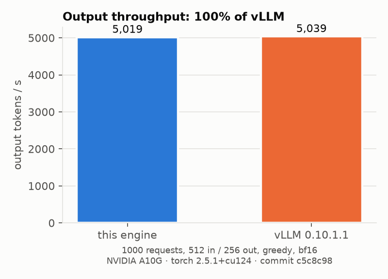
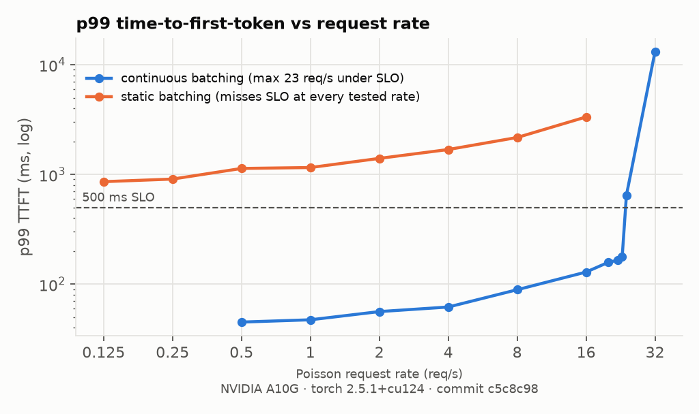
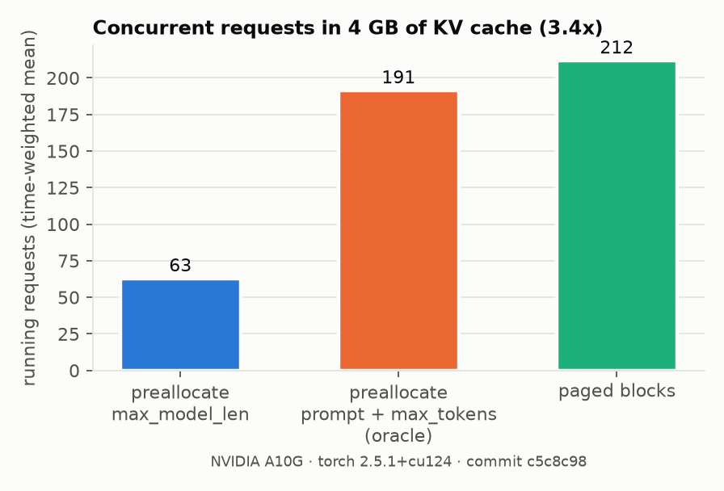
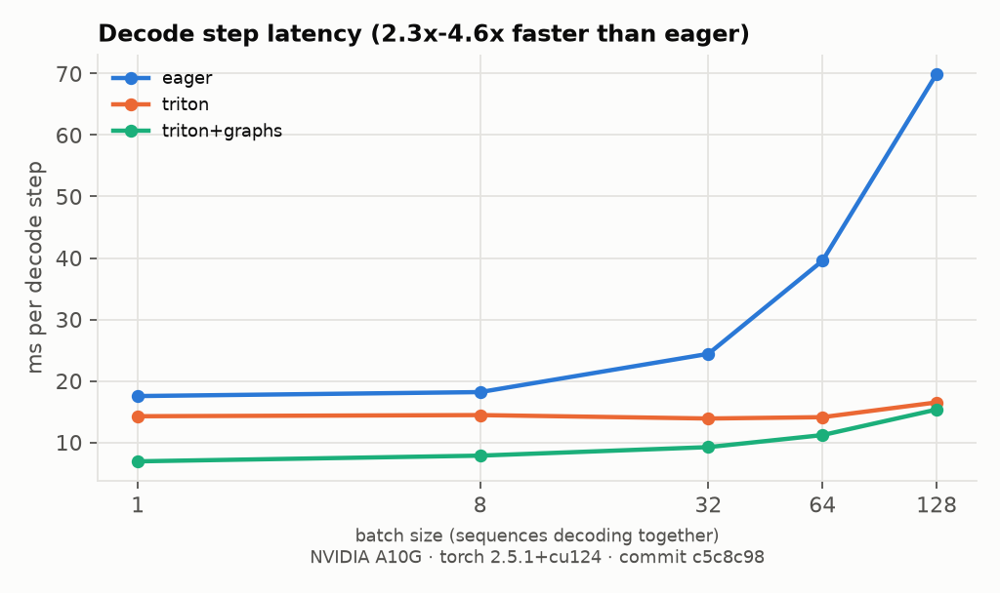
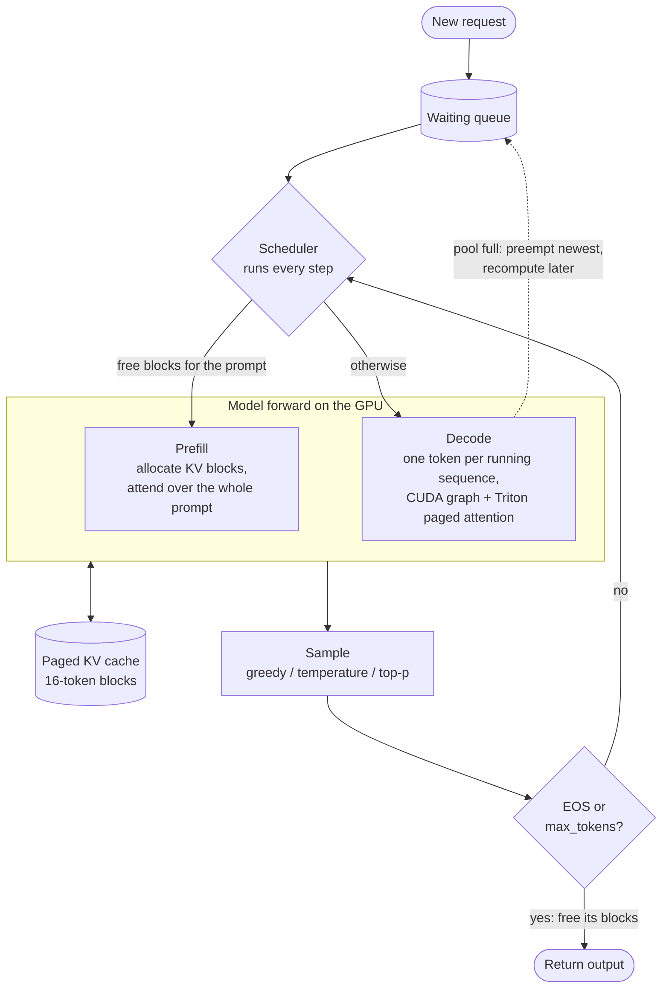
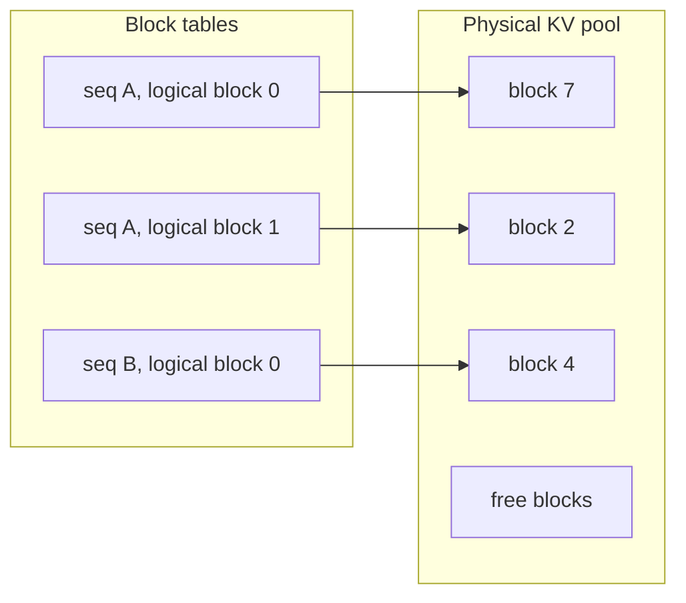

# llm-inference-engine

An LLM inference engine written from scratch in Python, PyTorch and Triton. It serves Llama-3.2-1B
(bf16) on a single NVIDIA A10G using continuous batching, a paged KV cache, a Triton
paged-attention kernel and decode steps captured as CUDA graphs. The engine itself is about
950 lines of code.

## Results

All measurements: one NVIDIA A10G (24 GB), Llama-3.2-1B, bf16.

| | Result |
|---|---|
| **Throughput** | **5,019 output tok/s**, which is **99.6% of vLLM 0.10.1.1** (5,039 tok/s) on the same benchmark |
| **Serving under an SLO** | Continuous batching sustains **23 req/s** with p99 TTFT under 500 ms. Static batching misses that SLO at **every** tested rate from 0.125 to 16 req/s |
| **KV memory** | Paged allocation runs **3.4× more concurrent requests** than per-request preallocation in the same 4 GB of KV cache (212 vs 63 on average; 3.8× at peak) |
| **Decode latency** | The Triton kernel with CUDA graphs makes a decode step **2.5× faster** than eager PyTorch at batch 1, and 2.3–4.6× faster across batch sizes 1–128 |
| **Correctness** | In fp32, greedy outputs match Hugging Face Transformers on **999/1,000 prompts**. The remaining prompt diverges at a numerical tie (HF's own top-2 logits differ by 1.3e-5) |

<p align="center">
  
  
  
  
</p>

The raw data for every number is in [`results/`](results/): one JSON file per benchmark, the full
log of each run, and profiler traces. Each file records the full `nvidia-smi` output (GPU UUID
and driver), the library versions, the git commit it ran from and the Modal task ID.
[`modal_app.py`](modal_app.py) only runs on an A10G; Modal's "A10G" pool also contains A10s,
which would make results incomparable.

## Architecture



Each sequence has a **block table** that maps its logical KV blocks to physical blocks anywhere in
a shared pool, the same way a page table maps virtual pages to physical frames:



```
engine/
├── model.py             Llama 3: RMSNorm, Llama-3 RoPE scaling, GQA, SwiGLU; loads HF safetensors
├── block_manager.py     paged KV allocator (also the preallocation baselines)
├── scheduler.py         continuous batching, admission control, recompute preemption (also the static baseline)
├── attention.py         writes K/V into the paged cache; prefill attention; eager paged-attention reference
├── triton_attention.py  Triton paged decode-attention kernel
├── cuda_graph.py        decode step captured as one CUDA graph per batch-size bucket
└── engine.py            step loop, input preparation, KV pool sizing
bench/                   one script per result, plus plots.py
tests/                   allocator and scheduler unit tests; GPU tests against HF and the eager path
modal_app.py             runs any test or benchmark on a cloud A10G
```

## Design notes

**Paged KV cache.** Each layer's cache has shape `[num_blocks, 16, 8, 64]` (blocks, tokens per
block, KV heads, head dim). One token of KV costs 32 KB, so a block is 512 KB. Blocks are taken
one at a time as a sequence grows and returned as soon as it finishes, so no memory sits reserved
for tokens that may never be generated. Block 0 is reserved as scratch space for the padding rows
of CUDA-graph batches.

**Scheduler.** At every step it either admits waiting requests (a prefill step) or advances all
running sequences by one token (a decode step). New requests join a batch that is already running,
as soon as there are blocks for their prompt; 1% of the pool is held back so running sequences can
keep growing. If the pool runs out during decode, the most recently admitted sequence is preempted
and later recomputed from its tokens. A test checks that preemption does not change any output.

**Triton kernel.** One program handles one (sequence, KV head, context split) and covers all
4 query heads that share that KV head (GQA), padded to 16 rows so QKᵀ and PV run on tensor cores.
It loads K/V tiles through the block table and keeps a running max and running sum (online
softmax), so the full row of scores is never stored. When batch × KV heads is too small to fill
the SMs, the context is split across several programs and a second kernel merges the partial
results (split-K, as in FlashDecoding). At batch ≥ 32 the kernel reads K/V at 415–435 GB/s, out
of the A10G's 600 GB/s peak. At batch 256 it takes 0.65 ms per call, vs 6.58 ms for the eager
gather version ([microbenchmark](results/kernel_microbench.json)).

**CUDA graphs.** In eager mode, one decode step launches about 950 kernels, and at small batch
sizes Python cannot launch them as fast as the GPU finishes them. So decode is captured once per
batch-size bucket (1, 2, 4, 8, then every 16 up to 256), using persistent input buffers, and each
batch is padded up to the next bucket. In the profiler traces ([`results/traces/`](results/traces),
viewable in [Perfetto](https://ui.perfetto.dev)), five decode steps at batch 8 take 134 ms of CPU
time in eager mode and 40 ms with graphs.

**Correctness.** The parity benchmark runs 1,000 Alpaca prompts through the full production path
at once: batching, paged cache, Triton kernel and CUDA graphs. It compares every token with HF
`generate(do_sample=False)`, which runs each prompt alone. The check is done in fp32. In bf16, two
correct kernels that sum in a different order round differently, which flips near-ties: 599/1,000
prompts are identical in bf16, and 396 of the 401 divergences occur where HF's top-2 logits are
within 0.25 of each other.

## Methodology

| Benchmark | Setup |
|---|---|
| [Throughput vs vLLM](bench/throughput.py) | 1,000 requests, 512 random prompt tokens and 256 output tokens each. Identical token IDs, greedy decoding, `ignore_eos`, bf16, `max_num_seqs=256`, `max_model_len=2048`, 90% GPU memory. vLLM runs with prefix caching and detokenization off. One warmup batch first |
| [SLO sweep](bench/serving.py) | Open-loop Poisson arrivals, at least 200 requests per rate. Prompts are 512 ± 50% tokens and outputs 128 ± 50%. TTFT includes queueing. Continuous batching: the rate doubles until the SLO breaks, then bisection. Static batching uses the same engine but runs each batch to completion before admitting more, so it was measured on a fixed grid of rates |
| [KV memory](bench/memory.py) | Fixed 4 GB KV pool, 2,000 requests submitted at once. The baseline reserves `max_model_len` (2,048 tokens) per request. An oracle that reserves exactly prompt + `max_tokens` fits 191 requests, and paged allocation still beats it by 1.1×. Concurrency is a time-weighted mean |
| [Decode latency](bench/latency.py) | Median wall time of a decode step (sampling and host work included), 512-token prompts. Three configurations: eager gather attention, the Triton kernel, and the Triton kernel with CUDA graphs |

How the static batching gap changes as the SLO loosens:

| p99 TTFT SLO | Continuous batching | Static batching |
|---|---|---|
| 500 ms | 23 req/s | fails at every tested rate, down to 0.125 req/s |
| 1 s | ≥ 24 req/s | 0.25 req/s |
| 2 s | ≥ 24 req/s | 4 req/s |
| 5 s | ≥ 24 req/s | ≥ 16 req/s |

## Usage

```python
from transformers import AutoTokenizer
from engine.config import EngineConfig
from engine.engine import LLMEngine
from engine.sequence import SamplingParams

engine = LLMEngine(EngineConfig())  # downloads unsloth/Llama-3.2-1B, needs a CUDA GPU
tok = AutoTokenizer.from_pretrained(engine.model_dir)
prompts = [tok(p).input_ids for p in ["The capital of France is", "def fibonacci(n):"]]
for out in engine.generate(prompts, SamplingParams(max_tokens=32)):
    print(tok.decode(out))
```

## Reproducing the results

All GPU work runs on [Modal](https://modal.com). Each command copies its outputs into `results/`.

```bash
pip install modal && modal setup
modal run modal_app.py --cmd "pytest tests -v"
modal run modal_app.py --cmd bench.throughput
modal run modal_app.py --cmd bench.vllm_throughput --vllm
modal run modal_app.py --cmd "bench.serving --scheduling continuous"
modal run modal_app.py --cmd "bench.serving --scheduling static --rates 0.125,0.25,0.5,1,2,4,8,16"
modal run modal_app.py --cmd bench.memory
modal run modal_app.py --cmd bench.latency
modal run modal_app.py --cmd "bench.hf_parity --dtype float32"
modal run modal_app.py --cmd bench.profile_decode
python -m bench.plots
```

## Limitations

- **Prefill attention:** prompts are padded to the longest one in the step and run through PyTorch SDPA. A varlen kernel or chunked prefill would remove the padding.
- **CUDA graph coverage:** only pure decode steps are captured. Prefill and decode never share a step.
- **Host overhead:** scheduling and input preparation run synchronously in Python, whereas vLLM overlaps them with GPU work.
- **Not implemented:** prefix caching, speculative decoding, quantization, tensor parallelism.
